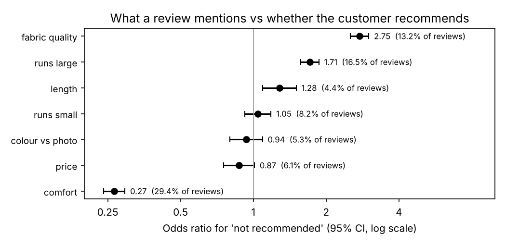
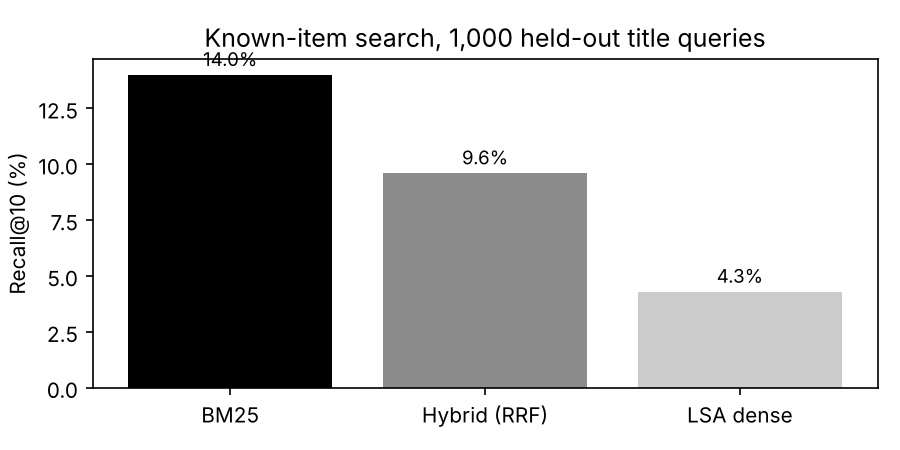

# Review Insights: Aspects, Classifier and Grounded Q&A

What 22,621 real clothing reviews say, which complaints go with customers not recommending an item, and an LLM
analyst that answers from retrieved reviews with citations that are checked before the answer is returned.

**What it shows**
- **Which complaints matter.** Fabric-quality complaints go with **2.75×** the odds of not recommending
  (95% CI 2.52–3.01) and "runs large" with 1.71×, while "runs small" shows no effect
  (1.05, CI 0.92–1.18). Comfort mentions go with 0.27×. Controlled for department and age band.
- **A leak-free classifier.** Text predicts "not recommended" at **ROC-AUC 0.9618** (95% CI 0.9556–0.967) with products split
  between train and test (0 products in both), so reviews of the same item cannot leak.
- **Retrieval measured without hand labels.** Known-item search (a review's title finds its own text): BM25 finds the right review
  in the top 10 for **14.0%** of 1,000 held-out queries, against 9.6% for a hybrid and 4.3% for dense LSA
  (random: 0.04%). Adding the dense retriever **hurt**, so BM25 was kept, chosen on separate validation queries.
- **Citation-checked answers, measured.** Every cited review ID must come from the search results and every quotation must appear in a
  retrieved review, else the agent retries, then refuses. With qwen2.5:7b this removed all 6 unsupported answers (5 invented citations,
  one number off by 10×) at the same supported accuracy, 61%.



## Data
Women's E-Commerce Clothing Reviews (Nick Brooks, "nicapotato" on Kaggle, 2018; CC0): 23,486 reviews; removed 845 without text, 7 duplicate texts and
13 without a department → **22,621 reviews of 1,170 products** in 6 departments. `scripts/get_data.sh` downloads it.

Label check: 187 reviews rate 4–5 stars but do not recommend, 109 rate 1–2 stars but do;
41.4% of 3-star reviews recommend. The recommend flag is used as the outcome because it is the customer's own yes/no.

## 1. Aspects and odds ratios
Eight transparent regex rules tag aspects (`src/rvi/aspects.py`). `eval/aspect_audit.csv` holds 20 random matches per aspect with an
empty column for a human to mark correct or wrong; rule precision is **not yet audited**. "Returning" is tagged but left out of
the model because it is a consequence of not liking the item, not a cause.

| Aspect | Share of reviews | Not recommended when present | Odds ratio | 95% CI |
|---|---|---|---|---|
| fabric quality | 13.2% | 33.7% | **2.75** | 2.52–3.01 |
| runs large | 16.5% | 25.5% | **1.71** | 1.57–1.87 |
| length | 4.4% | 22.1% | **1.28** | 1.09–1.50 |
| runs small | 8.2% | 19.5% | **1.05** | 0.92–1.18 |
| colour vs photo | 5.3% | 18.7% | **0.94** | 0.80–1.09 |
| price | 6.1% | 17.6% | **0.87** | 0.75–1.01 |
| comfort | 29.4% | 7.1% | **0.27** | 0.24–0.29 |

Base not-recommended rate: 18.1%. Logistic regression with department and age-band controls; associations, not causes.

| Department | Reviews | Not recommended | Runs small | Runs large | Fabric quality |
|---|---|---|---|---|---|
| Tops | 10,046 | 18.9% | 6.1% | 18.6% | 17.0% |
| Dresses | 6,144 | 19.5% | 9.3% | 15.9% | 10.5% |
| Bottoms | 3,661 | 15.0% | 10.9% | 14.1% | 7.6% |
| Intimate | 1,650 | 15.4% | 9.2% | 10.5% | 15.8% |
| Jackets | 1,002 | 16.7% | 10.2% | 17.2% | 9.7% |
| Trend | 118 | 25.4% | 12.7% | 19.5% | 9.3% |

## 2. Recommendation classifier
TF-IDF (1–2 grams) + logistic regression, class-weighted. Group split by clothing ID: 18,107 reviews / 936 products for training,
4,514 / 234 for testing.

| ROC-AUC | 95% CI | PR-AUC | Base rate | F1 at 0.5 |
|---|---|---|---|---|
| 0.9618 | 0.9556–0.967 | 0.8435 | 18.4% | 0.7847 |

Strongest "not recommended" terms: disappointed, not, to love, poor, unflattering, huge, was, cheap, returning, not flattering.

## 3. Retrieval benchmark
Query = a review's title (at least 4 words, unique in the corpus); target = that review's text; titles are not indexed.
300 validation queries pick the method; 1,000 different test queries score it.

| Retriever | Recall@1 | Recall@5 | Recall@10 | MRR@100 |
|---|---|---|---|---|
| BM25 **(champion)** | 5.9% | 11.1% | 14.0% | 0.0881 |
| Hybrid, RRF of BM25 + LSA | 3.2% | 6.4% | 9.6% | 0.0519 |
| LSA dense (TF-IDF + SVD, 200 dims) | 1.2% | 3.2% | 4.3% | 0.0236 |

Titles like "Love this dress so much" are generic, so absolute recall is low; the comparison between methods is the point.



## 4. LLM analyst agent
Tools: `search_reviews` (department and rating filters), `get_aspect_stats`, `get_odds_ratios`, behind FastAPI and an
OpenAI-compatible tool-calling loop (default: Ollama on localhost). Checks on every answer: numbers must match tool results, cited
IDs must be retrieved, quotes must be exact.
`eval/questions.jsonl`: 22 questions (12 statistics with known answers, 6 open questions that must be answered with at least two
valid citations, 4 that must be refused).
```bash
bash scripts/run_agent_eval.sh      # qwen2.5:7b via Ollama, with and without the checks
```
CI runs the harness with a scripted keyword router to test the plumbing; that is not a model result.

**Results: qwen2.5:7b via Ollama, temperature 0** (`reports/agent_eval_qwen2.5_7b*.json`, every answer checked against the tool outputs)

| | With checks | Without checks |
|---|---|---|
| Scored correct, 18 answerable questions | 61.1% | 83.3% |
| Answers given | 11 | 17 |
| **Answers with an invented citation or a wrong number** | **0** | **6** |
| **Correct and fully supported** | **61.1%** | **61.1%** |
| Correct refusals, 4 unanswerable questions | 4 / 4 | 4 / 4 |
| Median latency | 3.2 s | 2.7 s |

- Without the checks the model cited a review **[1234]** that no search returned in 5 answers, and once reported 1.7% of tops reviews
  mentioning fabric quality when the tool said **16.95%**. The higher unchecked score counts those answers as correct.
- With the checks it gave fewer answers but none of them was unsupported: the same supported accuracy, with no misleading answers.
- Remaining weakness: open "why" questions (returns, pilling) were routed to statistics tools instead of review search and refused.
- **The first run (kept in `reports/agent_eval_run1_*`)** exposed three harness issues, fixed before the run above: the citation checker
  only read `[123]` (so `[12, 34]` and "review ID 12" escaped checking), quoted labels such as "runs_large" were treated as quotations,
  and the statistics tool's description did not mention the not-recommended rate. No further tuning on these 22 questions after the second run.

## Run
```bash
pip install -e ".[dev]"
bash scripts/get_data.sh
python -m rvi.run && python -m rvi.charts      # ~3 min (retrieval benchmark is most of it)
pytest -q                                      # 8 tests
uvicorn rvi.api:app --port 8080                # /health /search /aspects /odds-ratios /predict
```

## Limitations
- Aspect rules are lexical and unaudited; negation ("not thin at all") is not handled.
- Known-item search tests whether a retriever can find a specific review, not whether it finds the most useful reviews for a question.
- No neural embeddings were available offline; a sentence-embedding retriever is the obvious next comparison.
